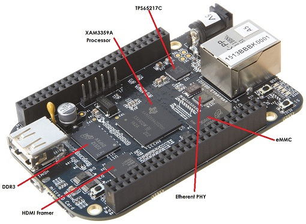
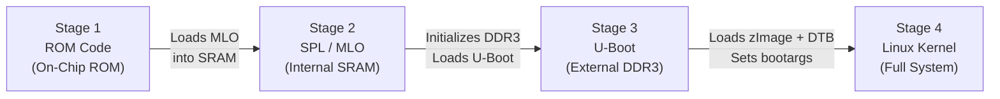
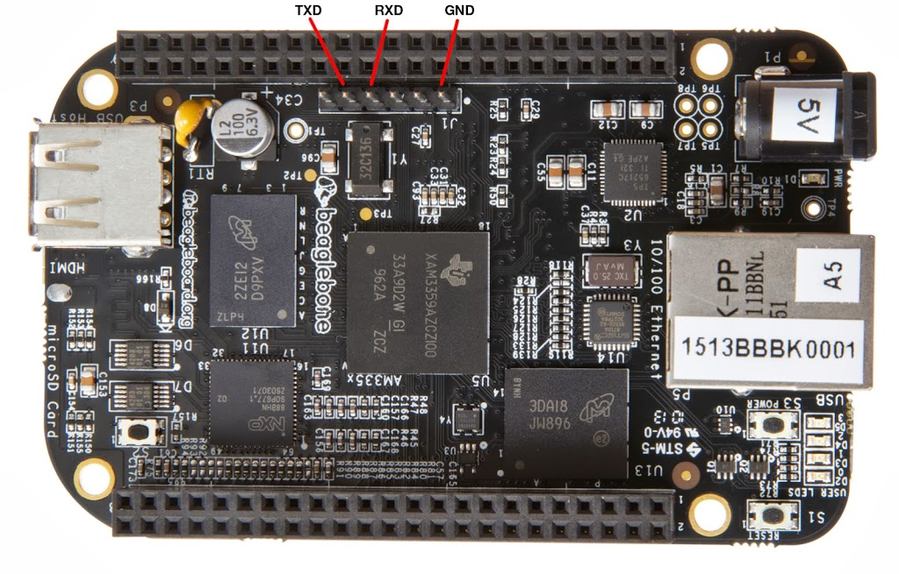
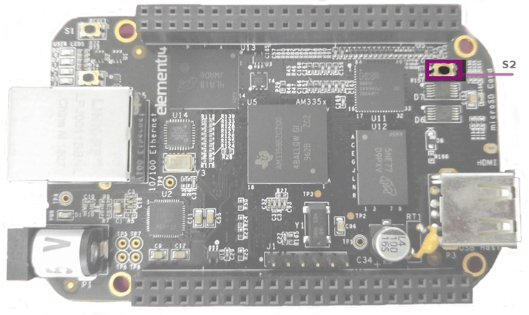

import Disk from '../../components/diagrams/Disk.astro';


<div class="fd-panel">

**Learning Objectives**
By the end of this module, you will be able to:
1. Describe the TI AM335x SoC hardware architecture and its 4-stage boot sequence
2. Build a Yocto image targeting the BeagleBone Black (`MACHINE = "beaglebone"`)
3. Partition an SD card, flash boot files, and boot the board via serial console
4. **Alternative:** Run the same image in QEMU if you don't have physical hardware

</div>

:::note[Prerequisites]
- Completed [Yocto foundations and fast emulation](../embedded-linux-yocto-foundations/) and [Yocto architecture, workflow and state](../yocto-architecture-terminology-workflow/)
- Yocto build environment set up with Poky cloned
- **Optional hardware:** BeagleBone Black board, USB-to-UART cable (FTDI/CP2102), MicroSD card (≥4 GB)
:::

---

## 🖥️ No Hardware? No Problem!

:::caution[Qemu emulation alternative]
**You do NOT need to purchase a BeagleBone Black to complete this course.** Yocto's built-in QEMU integration can emulate an ARM Cortex-A target, allowing you to practice image building, SD card layout concepts, and serial console interaction entirely in software.

Skip to [Section 7: QEMU Emulation Alternative](#_7-qemu-emulation-alternative-no-hardware-required) if you want to proceed without physical hardware.
:::

---

## 1. BeagleBone Black Hardware Overview

The **BeagleBone Black (BBB)** is one of the most popular single-board computers for learning embedded Linux. It is based on the Texas Instruments **AM3358** Sitara processor — a member of the AM335x family.



### 1.1 Hardware Specifications

| Component | Specification | Notes |
|---|---|---|
| **SoC** | Texas Instruments AM3358 | Sitara family, industrial-grade |
| **CPU** | ARM Cortex-A8 @ 1.0 GHz | Single-core, ARMv7-A architecture |
| **GPU** | PowerVR SGX530 @ 200 MHz | OpenGL ES 2.0, not commonly used in embedded Linux |
| **RAM** | 512 MB DDR3L (800 MHz) | Sufficient for headless Linux applications |
| **On-Board Storage** | 4 GB 8-bit eMMC | Pre-loaded with Debian/Ångström Linux |
| **External Storage** | MicroSD card slot | Primary boot target for custom images |
| **USB** | 1× USB 2.0 Host (Type-A), 1× Micro-USB Client (power + serial) | Client port provides serial console via FTDI |
| **Display** | Micro-HDMI output | Up to 1280×1024 |
| **Network** | 10/100 Ethernet (RJ45) | Powered by LAN8710A PHY |
| **Expansion** | 2× 46-pin headers (P8, P9) | 65 GPIOs, 7 ADC inputs (1.8V), 4 UART, 2 I2C, 2 SPI, 8 PWM |
| **Debug** | JTAG (via optional header) + Serial console (J1 header) | J1 header is 6-pin, 3.3V UART |

---

## 2. The 4-Stage Boot Sequence of the AM335x

Understanding the boot process is critical for debugging hardware bring-up. The AM335x uses a **4-stage boot pipeline** — each stage has progressively more hardware available:



### Stage 1: On-Chip ROM (Boot ROM)

When power is applied, the ARM Cortex-A8 CPU begins executing code from **internal ROM** at address `0x20000`. This ROM code is burned into the silicon at the factory and cannot be modified.

**What it does:**
- Checks the **boot pin configuration** (controlled by the S2 button) to determine the boot device priority order: eMMC → SD Card → UART → USB
- Initializes minimal clocks (CPU PLL, peripheral clocks)
- Reads the first sector of the selected boot device and loads the **Secondary Program Loader (SPL / `MLO`)** into the CPU's internal 128 KB SRAM
- Transfers execution to SPL

### Stage 2: Secondary Program Loader (SPL / `MLO`)

The SPL (also called `MLO` — MMC Loader) is a stripped-down bootloader that fits within the 128 KB internal SRAM constraint.

**What it does:**
- Initializes the **external DDR3 RAM controller** — this is the most critical step, as the full U-Boot bootloader is too large for internal SRAM
- Configures power management (if PMIC present)
- Loads the full `u-boot.img` from the boot device into DDR3 RAM
- Transfers execution to U-Boot

### Stage 3: U-Boot (`u-boot.img`)

Now running from external DDR3 with full memory available, U-Boot provides a rich bootloader environment.

**What it does:**
- Sets up environment variables (`bootcmd`, `bootargs`, `mmcdev`, `mmcroot`)
- Initializes storage drivers (eMMC, SD/MMC, USB, NAND, Ethernet for TFTP)
- Loads the Linux kernel image (`zImage`) and Device Tree Blob (`am335x-boneblack.dtb`) into RAM
- Passes kernel boot arguments (`root=/dev/mmcblk0p2 rootwait console=ttyO0,115200n8`)
- Transfers execution to the kernel entry point

### Stage 4: Linux Kernel

The kernel decompresses, initializes the CPU, configures the MMU (virtual memory), probes hardware devices described in the Device Tree, mounts the root filesystem, and launches `/sbin/init` (BusyBox init or systemd).

---

## 3. Building a Yocto Image for BeagleBone Black

### Step 1: Configure the Target Machine

Edit `conf/local.conf`:

```bash
# Set BeagleBone Black as the target machine
MACHINE = "beaglebone-yocto"
```

:::note[Machine name]
The machine name `beaglebone-yocto` is defined in `meta-yocto-bsp/conf/machine/beaglebone-yocto.conf`. Some BSP layers (like `meta-ti`) may define the machine as `beaglebone` instead. Always check which machine configurations are available with:
```bash
ls meta-yocto-bsp/conf/machine/
```
:::

### Step 2: Build the Image

```bash
bitbake core-image-minimal
```

### Step 3: Examine Build Outputs

After a successful build, the following artifacts appear in `tmp/deploy/images/beaglebone-yocto/`:

| File | Purpose |
|---|---|
| `MLO` | First-stage bootloader (SPL) for AM335x |
| `u-boot.img` | Second-stage U-Boot bootloader binary |
| `zImage` | Compressed ARM Linux kernel image |
| `am335x-boneblack.dtb` | Device Tree Blob describing BBB hardware |
| `core-image-minimal-beaglebone-yocto.tar.bz2` | Root filesystem archive |
| `core-image-minimal-beaglebone-yocto.wic` | Complete disk image (partitioned, ready to flash) |

---

## 4. Manual SD Card Partitioning & Flashing

The MicroSD card must be partitioned into two distinct regions:

<Disk
  caption="MicroSD layout for the BeagleBone Black: a small FAT32 boot partition, then an ext4 root filesystem filling the rest."
  rows={[
  {
    "parts": [
      {
        "name": "1: BOOT",
        "share": 1,
        "meta": "FAT32, 64 MB, bootable flag",
        "contents": "MLO, u-boot.img, zImage, am335x-boneblack.dtb"
      },
      {
        "name": "2: ROOTFS",
        "share": 2.5,
        "meta": "ext4, rest of the card",
        "contents": "Root filesystem: /, /usr, /etc, /lib, ..."
      }
    ]
  }
]}
/>

### Using WIC (Recommended — Automated)

Yocto generates a `.wic` file that contains a pre-partitioned, pre-populated disk image. This is the easiest method:

```bash
# Identify your SD card device (NEVER use /dev/sda!)
lsblk

# Flash the WIC image directly (assuming SD card is /dev/sdb)
sudo dd if=core-image-minimal-beaglebone-yocto.wic of=/dev/sdb bs=4M status=progress && sync
```

### Manual Method (Educational)

For understanding how boot media is structured, partition manually:

```bash
# Create partition table
sudo fdisk /dev/sdb
# n → p → 1 → +64M → t → c (FAT32 LBA) → a (bootable)
# n → p → 2 → (remaining space)
# w (write and exit)

# Format partitions
sudo mkfs.vfat -F 32 -n "BOOT" /dev/sdb1
sudo mkfs.ext4 -L "ROOTFS" /dev/sdb2

# Copy boot files
sudo mount /dev/sdb1 /mnt/boot
sudo cp MLO u-boot.img zImage am335x-boneblack.dtb /mnt/boot/
sudo umount /mnt/boot

# Extract rootfs
sudo mount /dev/sdb2 /mnt/rootfs
sudo tar -xf core-image-minimal-beaglebone-yocto.tar.bz2 -C /mnt/rootfs/
sudo umount /mnt/rootfs
sync
```

---

## 5. Serial Console Hardware Setup

The BeagleBone Black's **J1 header** provides a 3.3V UART serial console. Connect a USB-to-UART adapter (FTDI FT232R or CP2102):



### J1 Pinout Wiring

| J1 Pin | Function | USB-TTL Cable | Wire Color (typical) |
|---|---|---|---|
| Pin 1 | GND (Ground) | GND | Black |
| Pin 4 | RXD (Board receives) | TXD (Adapter sends) | White |
| Pin 5 | TXD (Board sends) | RXD (Adapter receives) | Green |

:::danger[Do not connect vcc]
Pin 3 on J1 is VCC (3.3V). **Do NOT connect this** — power the BeagleBone via the USB Client port or 5V barrel jack instead.
:::

### Launch Serial Console

```bash
# Add your user to the dialout group (one-time setup)
sudo usermod -aG dialout $USER

# Connect via picocom at 115200 baud, 8N1
picocom -b 115200 /dev/ttyUSB0

# Alternative: minicom
sudo minicom -D /dev/ttyUSB0 -b 115200
```

### Force Boot from SD Card (S2 Switch)



By default, the BBB boots from internal eMMC. To boot from the MicroSD card:
1. Insert the flashed MicroSD card
2. **Hold down the S2 button** (labelled "BOOT" near the MicroSD slot)
3. While holding S2, connect power (USB cable or barrel jack)
4. Release S2 after you see boot messages on the serial terminal

---

## 6. U-Boot Interactive Console

If you interrupt the U-Boot countdown by pressing any key during boot, you enter the U-Boot shell. Key commands:

```bash
# Print all environment variables
printenv

# Print specific variable
printenv bootcmd

# Show boot device order
printenv boot_targets

# Boot from SD card partition
setenv mmcdev 0
setenv mmcroot /dev/mmcblk0p2 ro
run bootcmd

# Boot from network (TFTP)
setenv serverip 192.168.1.100
tftpboot 0x82000000 zImage
bootz 0x82000000 - 0x88000000
```

---

## 7. QEMU Emulation Alternative (No Hardware Required)

If you don't have a BeagleBone Black, you can achieve equivalent learning outcomes using QEMU:

### Step 1: Build for QEMU ARM

```bash
# In conf/local.conf, set:
MACHINE = "qemuarm"
```

```bash
bitbake core-image-minimal
```

### Step 2: Boot in QEMU

```bash
# Graphical mode
runqemu qemuarm

# Serial console mode (recommended for SSH-based workflows)
runqemu qemuarm nographic
```

### Step 3: Practice the Same Skills

| Physical Board Skill | QEMU Equivalent |
|---|---|
| Understanding boot stages | Observe U-Boot → kernel → init sequence in QEMU serial output |
| SD card partitioning | Examine the generated `.wic` file layout with `fdisk -l *.wic` |
| Serial console interaction | QEMU `nographic` mode provides identical serial console experience |
| Verifying rootfs contents | Login as `root` and explore the filesystem |
| Adding packages | Same `IMAGE_INSTALL:append` workflow, rebuild, re-run `runqemu` |

:::tip[Renode for zynq-7000]
For Zynq-7000 targets (ZedBoard, PYNQ), **Renode** provides superior emulation with peripheral support. See the dedicated [Renode Emulation Guide](../renode-emulation-guide/) for details.
:::

---

## 8. Hands-On Lab Exercises

:::tip[LAB 3.1: Build & Boot (QEMU)]
1. Configure `MACHINE = "qemuarm"` in `conf/local.conf`
2. Run `bitbake core-image-minimal`
3. Boot with `runqemu qemuarm nographic`
4. At the login prompt, login as `root` and run `uname -a` to verify ARM architecture
5. Run `dmesg | head -50` to examine kernel boot messages
:::

:::tip[LAB 3.2: Examine WIC Image Layout]
1. After building, find the `.wic` file in `tmp/deploy/images/`
2. Run `fdisk -l *.wic` to inspect the partition table
3. Identify the boot partition (FAT) and rootfs partition (ext4)
4. Compare this layout with the manual partitioning steps in Section 4
:::

---

## 9. Further Reading

| Resource | URL |
|---|---|
| AM335x Technical Reference Manual | [ti.com/lit/ug/spruh73p](https://www.ti.com/lit/ug/spruh73p/spruh73p.pdf) |
| BeagleBone Black System Reference Manual | [beagleboard.org/black](https://beagleboard.org/black) |
| U-Boot Documentation | [docs.u-boot.org](https://docs.u-boot.org/en/latest/) |
| Yocto BSP Developer's Guide | [docs.yoctoproject.org/bsp-guide](https://docs.yoctoproject.org/bsp-guide/index.html) |

---

