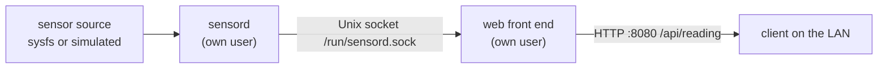

import LearningObjectives from '../../components/LearningObjectives.astro';
import Prerequisites from '../../components/Prerequisites.astro';

<LearningObjectives items={[
  "Split a device application into a data daemon and a network front end",
  "Package, start and confine both with Yocto and systemd",
  "Prove the service survives restarts, reboots and bad input",
]} />

<Prerequisites
  knowledge={["Module 6", "Writing recipes for C programs"]}
  software={["A systemd-based Yocto image for QEMU or a board"]}
/>

## Goal

A device reports a sensor value over HTTP. On QEMU the sensor can be simulated, for example by reading `/sys/class/thermal/thermal_zone0/temp` if present or generating a slowly changing value.

## Requirements

- `sensord` and the front end are separate processes running as separate unprivileged users.
- The socket is mode `0660`, group shared only by the two users.
- `GET /api/reading` returns JSON with the value and a timestamp; `GET /health` returns 200 or 503.
- Both run from systemd units with `Restart=on-failure` and the `Protect*` hardening options.
- A recipe builds and installs everything; nothing is copied by hand.
- The firewall allows port 8080 from the LAN only.

## Milestones

1. Write and test `sensord` on the host, then cross-compile.
2. Write the front end (CGI behind BusyBox httpd, or a small C or Python server).
3. Write the recipe with `useradd.bbclass` and `systemd.bbclass`.
4. Add the nftables rule and confirm with `nmap` from the host.
5. Failure testing: kill each process, reboot, send malformed requests.

## Acceptance checks

- `curl http://<device>:8080/api/reading` returns valid JSON after a cold boot with no manual steps.
- `kill -9` on either process is followed by an automatic restart (`journalctl` shows it).
- `ps -o user,comm` shows neither process running as root.
- A request with a 10 KB URL does not crash the front end.
