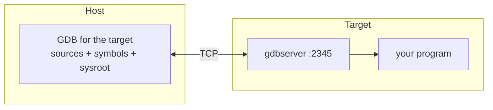

import LearningObjectives from '../../components/LearningObjectives.astro';
import Prerequisites from '../../components/Prerequisites.astro';
import Exercise from '../../components/Exercise.astro';

<LearningObjectives items={[
  "Explain why the debugger runs on the host and gdbserver on the target",
  "Build with debug symbols and point GDB at the right sysroot",
  "Set breakpoints and inspect variables in a remote process",
  "Load a core dump from the target into host GDB",
]} />

<Prerequisites
  knowledge={["Using GDB natively: break, run, next, print, bt"]}
  software={["A Yocto SDK with GDB for the target, or gdb-multiarch", "gdbserver installed on the target"]}
/>

## Why split the debugger

Full GDB needs your sources, the program's symbols and the symbols of every shared library. Those are large and live on the host. The target only needs `gdbserver`, a small program that controls the process and talks to GDB over TCP or a serial line.



## Get the pieces

In Yocto:

```bitbake
# conf/local.conf
EXTRA_IMAGE_FEATURES += "tools-debug"   # puts gdbserver (and gdb) on the target
IMAGE_GEN_DEBUGFS = "1"                 # builds a separate tree with debug symbols
```

`IMAGE_GEN_DEBUGFS` produces a `*-dbg.tar.bz2` next to your image. Unpack it over a copy of the root filesystem on the host; that copy is the sysroot GDB reads symbols from. The SDK from `bitbake -c populate_sdk your-image` includes a GDB built for your target, named for example `arm-poky-linux-gnueabi-gdb`.

Build your own program with `-g` and without stripping. Compiling with `-O0` makes stepping match the source; `-Og` is a good compromise when `-O0` changes the bug.

## A session

On the target:

```bash
gdbserver :2345 ./hello
```

On the host, from the SDK environment:

```bash
$GDB ./hello
(gdb) set sysroot /path/to/rootfs-with-dbg
(gdb) target remote 192.168.7.2:2345
(gdb) break main
(gdb) continue
(gdb) bt
```

To attach to something already running, use `gdbserver --attach :2345 <pid>` instead.

:::tip[Sysroot mismatches]
If GDB warns that it cannot find symbols for `libc.so.6`, or backtraces through library calls are full of `??`, the sysroot does not match the target's libraries. Rebuild the sysroot from the same image you flashed.
:::

## Core dumps

When a program crashes in the field you may not be there to attach. Let the kernel write a core file instead:

```bash
ulimit -c unlimited
echo "/var/crash/core.%e.%p" > /proc/sys/kernel/core_pattern
mkdir -p /var/crash
```

Copy the core file to the host and open it with the matching binary:

```bash
$GDB ./hello core.hello.1234
(gdb) set sysroot /path/to/rootfs-with-dbg
(gdb) bt full
```

On systemd images, `systemd-coredump` can collect cores for you; `coredumpctl list` shows them.

<Exercise
  title="Find a crash"
  difficulty="Advanced"
  instructions="Write a C program that dereferences a NULL pointer inside a function called from main. Build it with -g, run it under gdbserver on the target, and find the crashing line from host GDB. Then repeat with a core dump instead of gdbserver."
  hints={["After the SIGSEGV, 'bt' shows the call stack and 'frame 0' the faulting line.", "Remember the core file is only written if ulimit -c is not 0 in the shell that starts the program."]}
  expectedOutcome="Both methods point at the same source line with the NULL dereference."
  verificationSteps={["file core.* on the host reports an ELF core file for the target architecture", "bt shows your function names, not '??'"]}
  solution="If bt shows '??', the binary was stripped or the sysroot is wrong. Check with 'file hello' that it says 'with debug_info, not stripped', and that 'info sharedlibrary' in GDB lists libraries from your sysroot path."
/>
