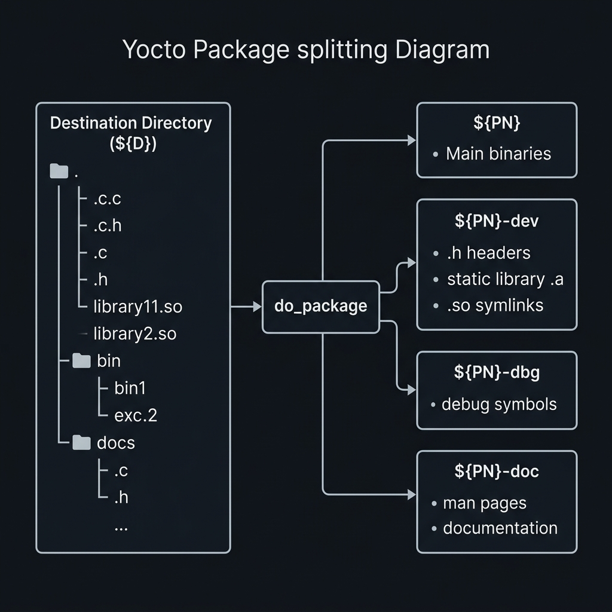

<div class="fd-panel">

**Learning Objectives**
By the end of this module, you will be able to:
1. Explain the `do_package` task and the concept of Yocto package splitting
2. Control which files go into which packages using the `FILES:${PN}` variable
3. Troubleshoot the dreaded `installed-vs-shipped` QA error
4. Inspect the generated RPM/IPK packages to verify their contents

</div>

:::note[Prerequisites]
- Completed [Git Repositories & Source Patching](../git-repositories-and-source-patching/)
:::

---

## 1. How Yocto Splits Packages

During the `do_install` task, a recipe installs *everything* (binaries, configuration files, man pages, C header files, static libraries, debug symbols) into the `${D}` (Destination) staging directory.

However, in an embedded system, disk space is at a premium. You don't want to install megabytes of C header files (`.h`) and debug symbols (`.debug`) onto the final production board.

To solve this, Yocto executes the **`do_package`** task. This task takes everything in `${D}` and splits it into granular, deployable packages (usually in `.rpm` or `.ipk` format) based on a set of rules.



### The Default `PACKAGES` Variable

By default, Yocto attempts to split the output into the following packages (defined by the `PACKAGES` variable):

```bash
PACKAGES = "${PN}-dbg ${PN}-staticdev ${PN}-dev ${PN}-doc ${PN}-locale ${PN}"
```
*(Note: `${PN}` stands for Package Name, e.g., `helloworld`)*

| Package | Purpose | Typical Contents |
|---|---|---|
| `${PN}-dbg` | Debugging symbols | `.debug/` directories, unstripped binaries |
| `${PN}-dev` | Development files | `.h` headers, `.so` symlinks, `.pc` pkg-config files |
| `${PN}-staticdev` | Static libraries | `.a` files |
| `${PN}-doc` | Documentation | `/usr/share/man`, `/usr/share/doc` |
| `${PN}` | The main binary package | `/usr/bin/`, `/etc/`, `.so.1` libraries |

---

## 2. Controlling the Split: `FILES:${PN}`

How does `do_package` know which file goes where? It looks at the `FILES` variable for each package.

Yocto has sensible defaults. For example, it automatically knows that anything ending in `.h` goes into `${PN}-dev`. Anything in `/usr/bin` goes into the main `${PN}` package.

But what if you install a custom configuration file into a non-standard path?

```bash
do_install() {
    install -d ${D}/opt/mycompany/
    install -m 0644 custom.conf ${D}/opt/mycompany/
}
```

Because `/opt/mycompany/custom.conf` doesn't match any default Yocto rules, it will get left behind. You must explicitly tell Yocto which package should claim it:

```bash
# Add the custom path to the main package's file list
FILES:${PN} += "/opt/mycompany/custom.conf"
```

---

## 3. The `installed-vs-shipped` Error

If you install a file into `${D}` during `do_install`, but *no* package claims it in their `FILES` variable, Yocto will halt the build with a **QA Issue**.

### Example Error Output
```text
ERROR: helloworld-1.0-r0 do_package: QA Issue: helloworld: 
Files/directories were installed but not shipped in any package:
  /opt/mycompany/custom.conf
Please set FILES such that these items are packaged. Alternatively if they are unneeded, avoid installing them or delete them within do_install. [installed-vs-shipped]
```

### How to Fix It
You have two choices:
1. **Ship it:** Add the path to `FILES:${PN} += "/opt/...""` as shown above.
2. **Don't install it:** If it's a useless file generated by a third-party Makefile, delete it at the end of `do_install`:
```bash
do_install:append() {
    rm -rf ${D}/opt/mycompany/useless_file.txt
}
```

---

## 4. Hands-On Lab Exercises

:::tip[LAB 11.1: Triggering the Error]
1. Open your `helloworld_1.0.bb` recipe.
2. Modify `do_install` to create a dummy file in a non-standard path:
   ```bash
   install -d ${D}/opt/test
   touch ${D}/opt/test/dummy.txt
   ```
3. Rebuild the recipe: `bitbake helloworld`.
4. Observe the red `[installed-vs-shipped]` QA error in the console.
5. Fix the error by adding `FILES:${PN} += "/opt/test/dummy.txt"` and rebuilding.
:::

:::tip[LAB 11.2: Inspecting the Generated Packages]
Let's look at the actual `.ipk` or `.rpm` files generated by the split.
1. Navigate to `build/tmp/deploy/rpm/cortexa8.../` (or `ipk/`).
2. You will see `helloworld-1.0-r0.cortexa8.rpm` and `helloworld-dbg-1.0-r0.cortexa8.rpm`.
3. You can list the contents of the main package without installing it:
   - For RPM: `rpm -qlp helloworld-1.0-r0...rpm`
   - For IPK: `ar p helloworld-1.0...ipk data.tar.gz | tar zt`
4. Verify your `/opt/test/dummy.txt` file is inside the main package!
:::

---

## 5. Further Reading

| Resource | URL |
|---|---|
| Package Splitting Mechanics | [docs.yoctoproject.org/dev-manual/packages.html](https://docs.yoctoproject.org/dev-manual/packages.html) |
| QA Error Reference | [docs.yoctoproject.org/ref-manual/qa-checks.html#qa-issue-installed-vs-shipped](https://docs.yoctoproject.org/ref-manual/qa-checks.html#qa-issue-installed-vs-shipped) |

---

