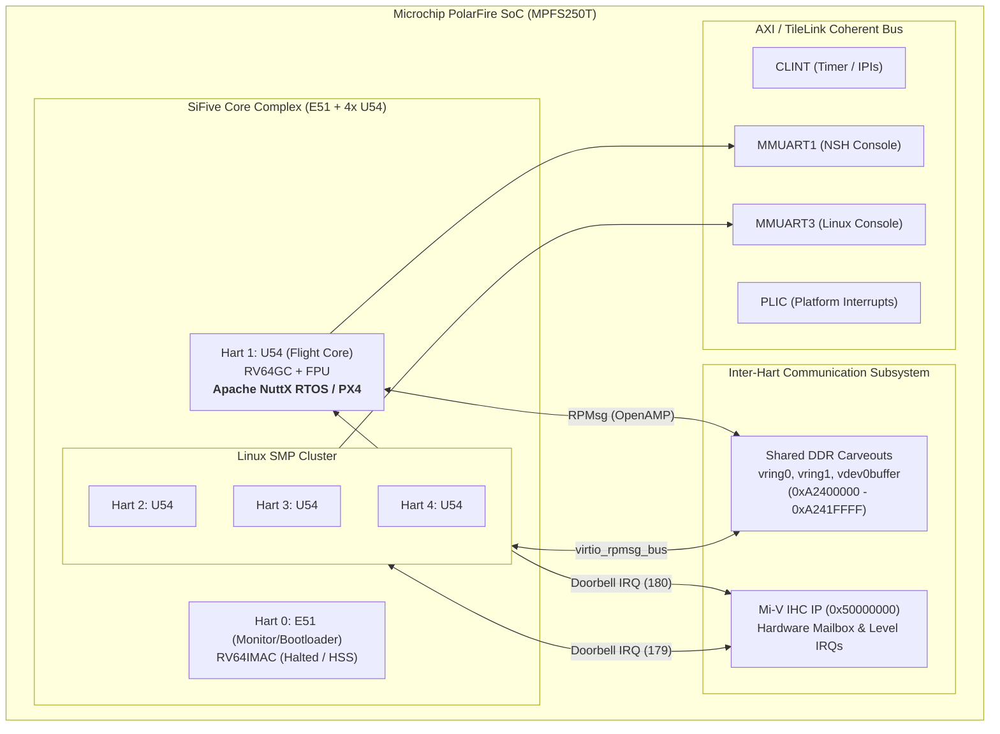
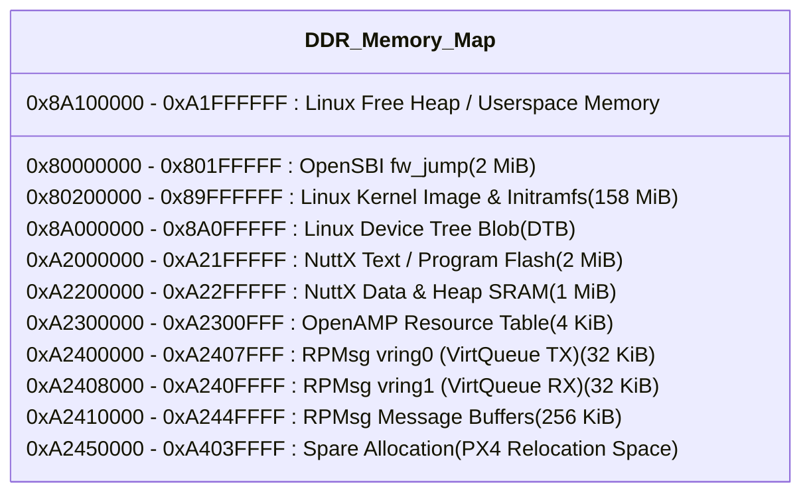
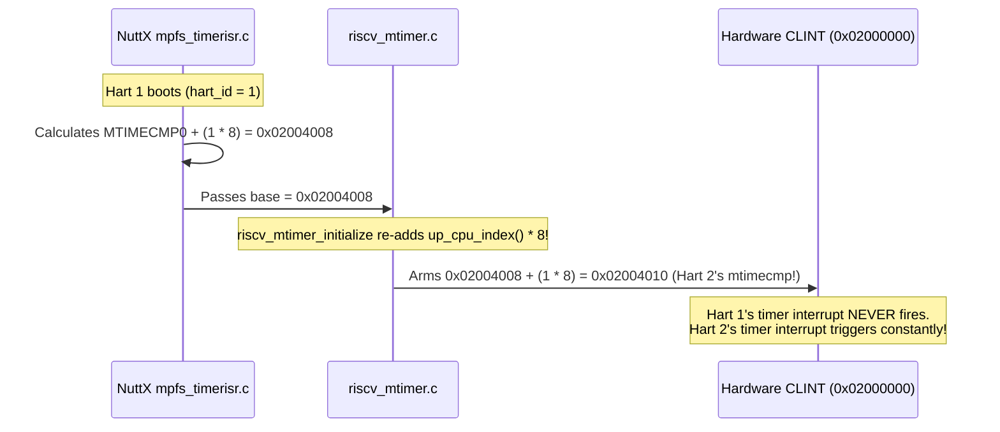
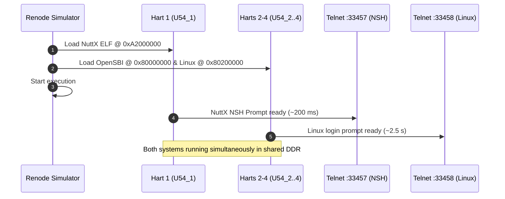
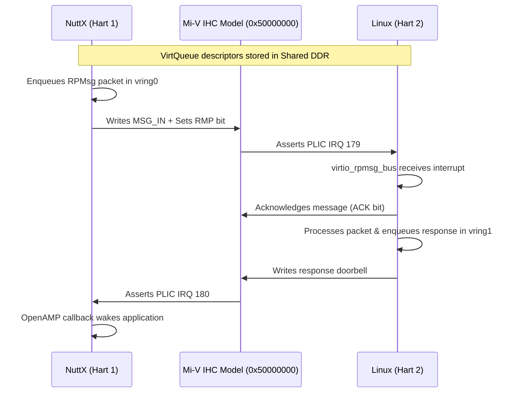
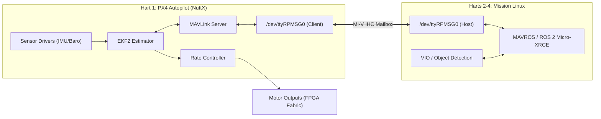

<div class="fd-panel">

**Project Overview: Single-Chip UAV Avionics SoC**
This comprehensive tutorial documents the complete development, architecture, emulation, and bug-resolution workflow of the **Chipwings** project: a single-chip Unmanned Aerial Vehicle (UAV) avionics computer based on the **Microchip PolarFire SoC (MPFS250T / Icicle Kit)**.

We implement an **Asymmetric Multiprocessing (AMP)** architecture combining hard real-time flight control (**Apache NuttX RTOS / PX4 Autopilot**) running on **Hart 1**, with an embedded **Linux SMP** mission stack running on **Harts 2–4**, communicating over **OpenAMP / RPMsg** via the **Mi-V Inter-Hart Communication (IHC)** hardware mailbox — fully modeled and simulated in **Renode** before deploying to physical silicon.

</div>

---

## 1. System Architecture & Theory of Operation

### 1.1 The Heterogeneous PolarFire SoC Architecture

The Microchip PolarFire SoC combines a coherent 64-bit RISC-V CPU subsystem (the Microchip MSS) with a low-power, non-volatile PolarFire FPGA fabric. The CPU subsystem contains five RISC-V cores (harts):

1. **Hart 0 (E51):** 64-bit RV64IMAC monitor core (M-mode only, no MMU/FPU, cacheless). Used as the primary system bootloader (HSS — Hart Software Services).
2. **Harts 1–4 (U54):** Four 64-bit RV64GC application cores (M/S/U-mode, 32 KiB L1 I/D caches, hardware FPU, Sv39 MMU, coherent 2 MiB L2 cache).



### 1.2 Core Partitioning Strategy

| Core | Architecture | Role | Operating System | Console Port |
|---|---|---|---|---|
| **Hart 0 (E51)** | RV64IMAC | Bootloader / Secure Monitor | HSS / Halted in sim | MMUART0 |
| **Hart 1 (U54)** | RV64GC | Flight Control / Hard Real-Time | **Apache NuttX 13.1 / PX4** | MMUART1 (`:33457`) |
| **Hart 2 (U54)** | RV64GC | Mission / Linux Boot Hart | **Linux 6.12 SMP** (Buildroot) | MMUART3 (`:33458`) |
| **Hart 3 (U54)** | RV64GC | Sensor Fusion / Vision | **Linux 6.12 SMP** | Shared console |
| **Hart 4 (U54)** | RV64GC | Telemetry / High-level Autonomy | **Linux 6.12 SMP** | Shared console |

---

## 2. DDR Memory Mapping & Carveouts

To prevent the Linux operating system from corrupting real-time RTOS code or shared message rings, physical DDR memory (`0x80000000` upwards) is partitioned strictly using Linux Device Tree `reserved-memory` nodes with the `no-map` attribute:



### Device Tree Reserved Memory Snippet (`chipwings-mpfs-linux.dts`)

```dts
reserved-memory {
    #address-cells = <2>;
    #size-cells = <2>;
    ranges;

    nuttx_fw: nuttx@a2000000 {
        reg = <0x0 0xa2000000 0x0 0x00300000>; /* 3 MiB: 2 MiB Code + 1 MiB RAM */
        no-map;
    };

    rsc_table: rsc-table@a2300000 {
        reg = <0x0 0xa2300000 0x0 0x00001000>; /* 4 KiB resource table */
        no-map;
    };

    vdev0buffer: vdev0buffer@a2410000 {
        compatible = "shared-dma-pool";
        reg = <0x0 0xa2410000 0x0 0x00040000>; /* 256 KiB packet buffers */
        no-map;
    };

    vdev0vring0: vdev0vring0@a2400000 {
        reg = <0x0 0xa2400000 0x0 0x00008000>; /* 32 KiB vring 0 */
        no-map;
    };

    vdev0vring1: vdev0vring1@a2408000 {
        reg = <0x0 0xa2408000 0x0 0x00008000>; /* 32 KiB vring 1 */
        no-map;
    };
};
```

---

## 3. Phase 0: Baseline PolarFire SoC Simulation in Renode

Before developing custom software, we establish a known-good baseline using Antmicro's prebuilt demo images on Renode 1.17.0.

### 3.1 Running Stock Demos

```bash
# Set Renode executable path
R=~/tools/renode_1.17.0-portable/renode

# 1. FreeRTOS + lwIP webserver smoke test on PSE (runs 3s virtual time then exits)
$R --console --disable-gui sim/phase0/freertos-smoke.resc < /dev/null

# 2. PolarFire SoC Icicle Linux SMP Boot (E51 HSS -> U-Boot -> Linux 5.6)
$R --disable-gui -P 33456 sim/phase0/icicle-linux.resc
```

### 3.2 Five Critical Renode Gotchas Discovered

:::tip[1. Resc Path Expansion]
Inside `.resc` files, always reference script-relative paths using `$ORIGIN/...` **without** the `@` prefix (`$ORIGIN/../images/...`). Using `@$ORIGIN` will fail to expand, and plain relative paths resolve against Renode's working directory rather than the script's directory.
:::

:::caution[2. Do Not `include` Stock Renode Scripts]
Stock Renode demo scripts declare remote variables like `$bin?=@https://dl.antmicro.com/...`. Renode unconditionally initiates network downloads for every default URL declared in an included script, even if you override the variable before the include statement! Always inline the target setup directly into your custom `.resc`.
:::

:::danger[3. Unconstrained Logging Slowdown (`logLevel 3`)]
The PolarFire SoC simulation models generate massive numbers of debug/warning messages (generating over 7.6 GB of logs in 3 seconds during a FreeRTOS boot). This slows simulation execution down by 500%. Always set `logLevel 3` (ERROR level) at the top of your scripts to suppress warnings.
:::

:::tip[4. Headless Execution with Telnet Monitor]
When running headless scripts in automation:
- Using `--console` terminates Renode as soon as `stdin` hits EOF.
- Using `-P <port>` (e.g., `-P 33456`) keeps Renode alive in the background and opens a telnet listener for the Renode Monitor.
:::

:::caution[5. Network Fetch Retries]
Renode and build tools frequently encounter TLS handshake resets when fetching large assets from GitHub releases or Antmicro repositories. Always pass `--retry 5 --retry-all-errors` to `curl`.
:::

---

## 4. Phase 1: Real-Time NuttX on Hart 1

In Phase 1, we compile Apache NuttX RTOS targeting solely the flight-control core (Hart 1), leaving the remaining cores in reset.

### 4.1 Toolchain & Build Setup

- **Toolchain:** xPack `riscv-none-elf-gcc` 15.2.0-1 located in `~/tools/xpack-riscv-none-elf-gcc-15.2.0-1/bin`.
- **Sources:** Apache NuttX RTOS & Apps tag `nuttx-13.1.0`.
- **Target Configuration:** `sw/configs/nsh-hart1` (configured for single-core NSH linking at `0x80000000`).

To build:
```bash
cd /home/szyfrowac/BITS/4-1/Projects/Chipwings
./sw/build-nuttx.sh
```

### 4.2 Renode Emulation Script (`sim/phase1/nuttx-hart1.resc`)

```resc
using sysbus
mach create "chipwings"
machine LoadPlatformDescription @$ORIGIN/../platforms/chipwings-mpfs.repl

# Mute high-frequency peripheral logging
logLevel 3

# Halt E51 monitor and unused U54 cores (2, 3, 4)
e51 IsHalted true
u54_2 IsHalted true
u54_3 IsHalted true
u54_4 IsHalted true

# Load NuttX ELF directly onto Hart 1 and start
sysbus LoadELF @$ORIGIN/../../sw/nuttx/nuttx false u54_1

# Attach virtual serial analyzer to MMUART1
emulation CreateServerSocketTerminal 33457 "term1" false
connector Connect sysbus.mmuart1 term1

start
```

### 4.3 Bug Deep-Dive: The Double-Hart-Offset Bug in NuttX MTIMER

During early boots in Renode, NuttX initialized successfully but froze immediately upon executing its first `usleep()` or semaphore wait. The system tick count remained permanently zero (`g_system_ticks == 0`).



#### The Upstream Bug (`mpfs_timerisr.c`)
In upstream NuttX master, `mpfs_timerisr.c` contained the following logic:

```c
/* BUGGY UPSTREAM IMPLEMENTATION */
void mpfs_timerisr_initialize(void)
{
    uintptr_t mtimecmp = MPFS_CLINT_MTIMECMP0 + (up_cpu_index() * sizeof(uint64_t));
    /* ... */
    riscv_mtimer_initialize(MPFS_CLINT_MTIME, mtimecmp, RISCV_MTIMER_FREQ);
}
```

However, `riscv_mtimer_initialize()` in the generic RISC-V architecture layer internally does:
```c
/* riscv_mtimer.c */
int riscv_mtimer_initialize(uintptr_t mtime, uintptr_t mtimecmp, uint64_t freq)
{
    /* It adds the CPU offset AGAIN! */
    g_mtimer.mtimecmp = mtimecmp + (up_cpu_index() * sizeof(uint64_t));
}
```

Because both layers added `hart_id * 8`, on Hart 1 the timer register was configured at `0x02004000 + 8 + 8 = 0x02004010` — which is **Hart 2's `mtimecmp`**!
- Hart 1 received no timer interrupts, hanging all timing functions.
- On physical hardware, this would corrupt Linux Hart 2's kernel tick!

#### The Patch (`sw/patches/0001-mpfs-timerisr-fix-double-hart-offset-for-mtimecmp.patch`)
```diff
--- a/arch/risc-v/src/mpfs/mpfs_timerisr.c
+++ b/arch/risc-v/src/mpfs/mpfs_timerisr.c
@@ -62,7 +62,7 @@ void mpfs_timerisr_initialize(void)
 {
-  uintptr_t mtimecmp = MPFS_CLINT_MTIMECMP0 + (up_cpu_index() * sizeof(uint64_t));
+  uintptr_t mtimecmp = MPFS_CLINT_MTIMECMP0;
   riscv_mtimer_initialize(MPFS_CLINT_MTIME, mtimecmp, RISCV_MTIMER_FREQ);
 }
```

### 4.4 Verification & Validation

1. **Verify Hart Isolation:** Run `sim/phase1/check-one-core.sh`:
   ```bash
   $ sim/phase1/check-one-core.sh 33456
   e51:   halted, 0 instructions executed
   u54_1: RUNNING, PC=0x80001248, 854,209,112 instructions
   u54_2: halted, 0 instructions executed
   u54_3: halted, 0 instructions executed
   u54_4: halted, 0 instructions executed
   ```
2. **In-OS Validation:** Connect to NSH on telnet port `33457`:
   ```text
   nsh> hartinfo
   Physical hart (mhartid) : 1 (U54_1)
   NuttX SMP               : disabled
   nsh> ostest
   ...
   ostest_main: Exiting with status 0 (PASSED)
   ```

---

## 5. Phase 2: Linux SMP on Application Harts 2–4

In Phase 2, we build and boot a custom 3-core Linux SMP operating system on Harts 2, 3, and 4, ensuring Hart 1 and E51 are left untouched.

### 5.1 Build Pipeline & Components

- **Buildroot 2026.02 LTS:** Provides root filesystem, BusyBox, glibc cross-compiler.
- **Kernel:** Microchip official vendor kernel `linux4microchip+fpga-2025.10` (Linux 6.12.48 LTS).
- **OpenSBI:** OpenSBI 1.7 `fw_jump` firmware.
- **Device Tree:** Custom `chipwings-mpfs-linux.dts` declaring 3 CPU nodes (`hart2`, `hart3`, `hart4`) and reserving NuttX DDR carveouts.

To build:
```bash
./sw/build-linux.sh
```

### 5.2 Bug Deep-Dive: The OpenSBI CLINT Hart Offset Disaster

During early boots, Linux would boot OpenSBI and print the primary banner on Hart 2, but hang indefinitely at:
```text
[    0.052103] smp: Bringing up secondary CPUs ...
```

#### Root Cause Analysis
In `mpfs.dtsi`, the E51 core's interrupts in the CLINT node were specified as:
```dts
clint: clint@2000000 {
    interrupts-extended = <&cpu0 3 &cpu0 7
                           &cpu1 3 &cpu1 7
                           &cpu2 3 &cpu2 7 ...>;
};
```
Because the E51 was disabled or marked `0xffffffff`, generic OpenSBI assumed CLINT slot 0 was mapped to **Hart 1**. Consequently, every U54 index was shifted by 1:
- Hart 2 attempted to read/clear Hart 1's CLINT registers.
- When OpenSBI raised an Inter-Processor Interrupt (IPI) to wake Hart 3, it sent the IPI to the wrong core.
- The IPI flag in `msip` was never acknowledged or cleared, causing an infinite interrupt storm that locked the kernel.

#### Solution
In `chipwings-mpfs-linux.dts`, the CLINT interrupts were explicitly mapped to preserve exact physical hart indices:
```dts
&clint {
    interrupts-extended = <
        &cpu0 3 &cpu0 7
        &cpu1 3 &cpu1 7
        &cpu2 3 &cpu2 7
        &cpu3 3 &cpu3 7
        &cpu4 3 &cpu4 7
    >;
};
```

### 5.3 Hardware/Renode Workarounds
1. **Clock Configuration (`clkcfg`):** The PolarFire MSS PLL clock driver tries to query unmodeled MSS registers, forcing MMUART3 into reset. We disable `clkcfg` and configure MMUART3 with a fixed 150 MHz reference clock.
2. **System Controller Mailbox:** The hardware syscontroller mailbox is disabled in DTS as Renode does not implement SC crypto routines.

### 5.4 Verification & Validation

Connect via telnet to port `33458`:
```text
chipwings login: root
# nproc
3
# cat /proc/cpuinfo | grep "hart"
hart            : 2
hart            : 3
hart            : 4
# cat /proc/iomem | grep -i "reserved"
a2000000-a403ffff : Reserved
```

---

## 6. Phase 3: AMP Concurrency (NuttX + Linux)

Phase 3 merges Phase 1 and Phase 2 into a single unified simulation.



### 6.1 Relinking NuttX for AMP (`sw/configs/nsh-amp-hart1`)

NuttX cannot boot at `0x80000000` because OpenSBI and the Linux kernel occupy that range. We provide a custom linker script (`ld.script`) placing NuttX in the reserved region:
- **Flash/Text:** 2 MiB at `0xA2000000`.
- **SRAM/Heap:** 1 MiB at `0xA2200000`.

To build:
```bash
./sw/build-nuttx.sh nsh-amp-hart1
```

### 6.2 Running AMP Simulation (`sim/phase3/amp.resc`)

```bash
# Run headless
./sim/phase3/run.sh headless
```

### 6.3 Concurrency & Stress Verification

We verify that heavy compute operations on Linux do not introduce jitter or memory corruption into NuttX.

1. In Linux console (`telnet localhost 33458`), spawn 3 infinite compute loops:
   ```bash
   for i in $(seq 1 3); do sha256sum /dev/zero & done
   top # Observe 100% CPU utilization across Harts 2, 3, and 4
   ```
2. In NuttX console (`telnet localhost 33457`), run the full RTOS test suite:
   ```text
   nsh> ostest
   ...
   ostest_main: Exiting with status 0
   ```
   **Result:** `ostest` completed 32 test groups with exit code 0. Linux `dmesg` reported 0 RCU stalls, 0 soft lockups, and uniform interrupt distribution.

---

## 7. Phase 4: Inter-Core RPMsg & Mi-V IHC Hardware Mailbox

Phase 4 establishes real-time message passing between NuttX and Linux using **OpenAMP** on NuttX and `virtio_rpmsg_bus` on Linux.

### 7.1 The Mi-V Inter-Hart Communication (IHC) IP

The PolarFire SoC uses the Mi-V IHC memory-mapped hardware peripheral (`0x50000000`) to send interrupt doorbells between cores:
- Each hart pair has dedicated `CTRL`, `MSG_IN`, and `MSG_OUT` registers.
- **Sending:** The sender writes a 4-word message and sets `RMP` (Remote Message Present).
- **Receiving:** The receiver observes the `MP` (Message Present) bit and receives an interrupt.
- **Acknowledging:** Writing `ACK=1` asserts the acknowledgment line back to the sender. Writing `ACK_CLR=0` clears the incoming ack.



### 7.2 Emulating the IHC in Renode (`sim/peripherals/MiV_IHC.cs`)

Because upstream Renode did not include a PolarFire IHC peripheral, we wrote `MiV_IHC.cs` in C#. Key aspects of the model:
- Implements `IDoubleWordPeripheral` and `IKnownSize`.
- Exposes level-triggered GPIO IRQ outputs connected to the PLIC:
  - Hart 1 IRQ -> PLIC 180
  - Hart 2 IRQ -> PLIC 179
- Accurately models the atomic read-modify-write semantics of `ACK_CLR` (reads as 1 to avoid accidental clearing during bitwise operations).

### 7.3 Resolving Critical Concurrency & Driver Bugs

#### Bug 1: Renode Multi-Threaded IPI Bit Drop Race
Under parallel CPU simulation, Renode executes each CPU core on an independent host OS thread. When Hart 3 generated an IPI to Hart 2, `BaseRiscV.OnGPIO` called `TlibSetMipBit` directly on the calling thread while Hart 2 was concurrently modifying its own `mip` register (to service timer interrupts).
- **Consequence:** Hart 2 lost its `MSIP` bit update, causing Linux to freeze inside `tlb_sync` during remote TLB flushes.
- **Solution:** We developed `SafeIrqRiscV64.cs` and `SafeIpiCoreLevelInterruptor.cs` in `sim/platforms/chipwings-mpfs.repl`. Foreign-thread interrupt requests are queued and synchronized to safe execution points.

#### Bug 2: RPMsg Lockup After 107 Packets (`sw/patches/0003`)
In NuttX's `mpfs_rptun.c`, `mpfs_rptun_notify()` gave up after 5 retries if a Linux incoming message was pending. Furthermore, when an incoming ACK was received, the interrupt service routine mistakenly processed the stale message payload as a new notification.
- **Fix:** Patch `0003` enforces that messages are only read when the `MP` bit is strictly asserted, and retries notifications with a 10 ms timeout window.

#### Bug 3: Autostarting the Resource Table (`cwinit`)
Linux's `miv_remoteproc` driver attaches to the remote core by reading the OpenAMP resource table from DDR. If the table contains all zeros, Linux skips RPMsg channel setup.
- **Fix:** We wrote a custom startup app `sw/chipwings-apps/cwinit` configured as `CONFIG_INIT_ENTRYPOINT`. It invokes `RPTUNIOC_START` on `/dev/rptun/mpfsihc` to populate the resource table *before* NSH or Linux starts.

---

## 8. Practical Hands-On Verification Suite

The repository includes a comprehensive, automated verification testbench in `examples/run_examples.py`.

### 8.1 Example Test Catalog

| Test Program | Platform | Functionality Verified |
|---|---|---|
| `cw_timer` | NuttX (NSH) | Verifies high-precision wakeups using `clock_nanosleep(TIMER_ABSTIME)`. Proves 0 drift and timer jitter $< 2$ ticks. |
| `cw_threads` | NuttX (NSH) | Verifies pthread POSIX message queue concurrency, mutex locking, and counting semaphores across multiple worker tasks. |
| `cw_rpmsg_echo` | NuttX (NSH) | Registers OpenAMP endpoint `cw-echo`, mirroring all incoming RPMsg payloads back to the sender. |
| `cw_rpmsg_imu &` | NuttX (NSH) | Simulates a 100 Hz IMU sensor, streaming sequence IDs, timestamps, and 6-DOF data across RPMsg to Linux. |
| `hartcheck` | Linux | Validates `/proc/cpuinfo` and pins threads to guarantee execution occurs strictly on Harts 2, 3, and 4. |
| `rpmsg_ping` | Linux | Executes round-trip latency checks against NuttX's `rpmsg-ping` endpoint. |
| `rpmsg_echo` | Linux | Sweeps payload sizes from 1 byte to 496 bytes (maximum RPMsg packet size) to verify virtqueue integrity. |
| `rpmsg_imu` | Linux | Consumes the simulated IMU stream, verifying monotonic sequence IDs, timestamp jitter $< 5\%$, and sensor data integrity. |

### 8.2 Executing the Automated Verification Suite

```bash
# 1. Start Phase 4 AMP simulation in headless mode
./sim/phase4/run.sh headless

# 2. Run the automated test runner
python3 examples/run_examples.py
```

Expected Output:
```text
============================================================
              CHIPWINGS TEST SUITE EXECUTION
============================================================
[1/6] Running cw_timer on NuttX...................... PASS
[2/6] Running cw_threads on NuttX.................... PASS
[3/6] Running hartcheck on Linux..................... PASS
[4/6] Running rpmsg_ping (500 iterations)............ PASS
[5/6] Running rpmsg_echo (Payload sweep 1-496B)...... PASS
[6/6] Running rpmsg_imu (100 Hz stream validation)... PASS
============================================================
SUMMARY: 6/6 tests passed. Zero failures.
============================================================
```

---

## 9. Phase 5: PX4 Autopilot Architecture & Migration Plan

The ultimate objective of the Chipwings flight core is executing the **PX4 Autopilot** flight stack on Hart 1.



### 9.1 Core Porting Principle: Native STM32 Compatibility

When porting PX4 to a new semiconductor family, **never model the port after minimal community targets (e.g. RP2040 or ESP32)**. Minimal targets omit critical flight-controller features:
- Incomplete High-Resolution Timer (HRT) implementations.
- Missing hardware DMA or complex timer channels.
- Stripped down board initialization APIs.

**The Golden Rule:** Always model the port after PX4's primary reference target: **STM32 (`stm32_common` and `stm32h7`)**.
1. Mirror directory structures directly:
   `platforms/nuttx/src/px4/microchip/{microchip_common,mpfs}`
2. Model board layouts on reference flight controllers:
   `boards/chipwings/mpfs-hart1` modeled directly on `boards/px4/fmu-v6x`.

### 9.2 High Resolution Timer (HRT) Strategy

PX4 requires a microsecond-resolution hardware timer for sensor timestamping, control loops, and scheduling:
- **Time Base:** RISC-V CLINT `mtime` counter (running at 1 MHz, providing 64-bit microsecond counts without rollover).
- **Alarm Interrupt:** PolarFire MSS Timer 1 routed through PLIC IRQ 82 to generate precise preemption interrupts.

### 9.3 Inter-Core MAVLink Bridge

Rather than using physical external serial wires, PX4 communicates with Linux over RPMsg using a virtual serial driver:
- NuttX registers `/dev/ttyRPMSG0`.
- Linux loads the `rpmsg_tty` driver, creating `/dev/ttyRPMSG0`.
- PX4 runs standard MAVLink on `/dev/ttyRPMSG0`, providing transparent ROS 2 / MAVROS telemetry to Linux companion computer processes without external hardware latency.

---

## 10. Complete Command & Verification Cheat Sheet

```bash
# ==========================================
# 1. BUILD COMMANDS
# ==========================================

# Build NuttX single-core (Phase 1)
./sw/build-nuttx.sh nsh-hart1

# Build NuttX AMP image (Phase 3)
./sw/build-nuttx.sh nsh-amp-hart1

# Build NuttX RPMsg image (Phase 4)
./sw/build-nuttx.sh nsh-rpmsg-hart1

# Build Linux SMP Kernel & Rootfs (Phase 2)
./sw/build-linux.sh

# Rebuild only the Linux user examples
./sw/build-linux.sh chipwings-examples-rebuild all

# ==========================================
# 2. RUN SIMULATIONS (HEADLESS)
# ==========================================

# Phase 1: NuttX standalone (NSH on 33457, Monitor on 33456)
./sim/phase1/run.sh headless

# Phase 2: Linux standalone (Login on 33458, Monitor on 33456)
./sim/phase2/run.sh headless

# Phase 3: AMP NuttX + Linux concurrent
./sim/phase3/run.sh headless

# Phase 4: AMP with RPMsg Inter-Hart Mailbox
./sim/phase4/run.sh headless

# ==========================================
# 3. VERIFICATION & MONITOR COMMANDS
# ==========================================

# Check single-core CPU execution
./sim/phase1/check-one-core.sh 33456

# Connect to NuttX console
telnet localhost 33457

# Connect to Linux console (root / root)
telnet localhost 33458

# Run automated end-to-end tests
python3 examples/run_examples.py
```
