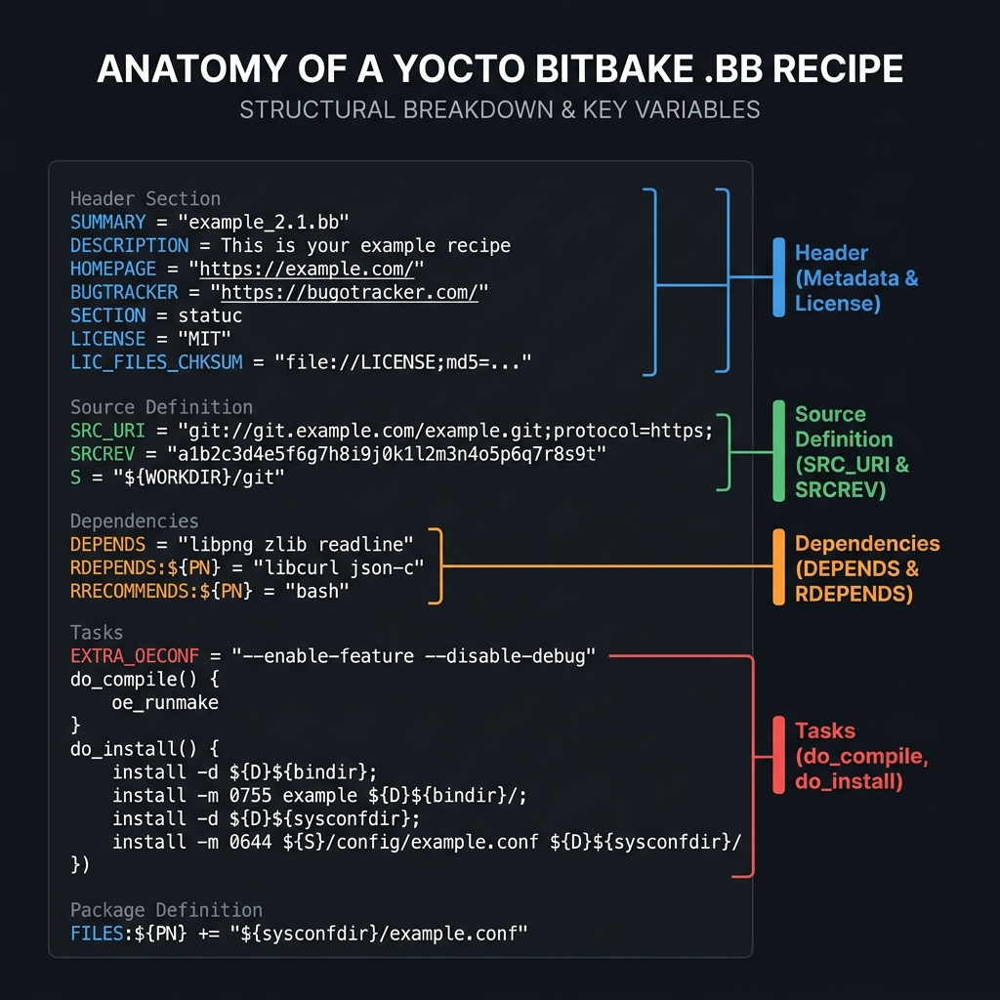

<div class="fd-panel">

**Learning Objectives**
By the end of this module, you will be able to:
1. Explain the anatomy of a Yocto `.bb` recipe and its essential variables
2. Write a custom recipe to cross-compile a local C application from scratch
3. Differentiate between `${WORKDIR}`, `${S}`, and `${D}` directories
4. Utilize `do_compile` and `do_install` tasks to build and stage binaries
5. Integrate your compiled application into a custom image

</div>

:::note[Prerequisites]
- Completed [Custom Image Recipes & Image Features](../custom-image-recipes-and-features/)
:::

---

## 1. Anatomy of a BitBake Recipe

A recipe (`.bb` file) is the fundamental unit of the Yocto build system. It instructs BitBake on how to fetch, patch, compile, and package a specific software component. 



### The Essential Variables

Every recipe must contain a core set of metadata variables to function correctly:

| Variable | Description |
|---|---|
| `SUMMARY` | A short, one-line description of the software. |
| `DESCRIPTION` | A longer, detailed description. |
| `LICENSE` | The open-source license (e.g., `"MIT"`, `"GPL-2.0-only"`). |
| `LIC_FILES_CHKSUM` | A cryptographic checksum of the license text file. BitBake checks this to ensure the license hasn't changed without you knowing. |
| `SRC_URI` | A space-separated list of source files (tarballs, git repos, or local files) to fetch. |
| `S` | The Source directory. Where the extracted source code lives (default is `${WORKDIR}/${BP}`). |

---

## 2. Compiling a Local C Application

Let's walk through creating a recipe that compiles a simple "Hello World" C program. We will store the `.c` file alongside the recipe.

### Step 1: Create the Recipe Directory Structure

Inside your `meta-myproject` layer, create a new directory for your recipe:

```bash
mkdir -p meta-myproject/recipes-example/helloworld/files
```

### Step 2: Create the Source Code

Create `helloworld.c` inside the `files/` subdirectory:

```c
// meta-myproject/recipes-example/helloworld/files/helloworld.c
#include <stdio.h>

int main() {
    printf("Hello from Yocto Embedded Linux!\n");
    return 0;
}
```

### Step 3: Write the Recipe

Create `helloworld_1.0.bb` inside `recipes-example/helloworld/`:

```bash
SUMMARY = "A simple Hello World C application"
LICENSE = "MIT"
LIC_FILES_CHKSUM = "file://${COMMON_LICENSE_DIR}/MIT;md5=0835ade698e0bcf8506ecda2f7b4f302"

# Point to our local C file. The file:// fetcher looks in the 'files/' subdirectory.
SRC_URI = "file://helloworld.c"

# Because we are compiling a single local file, there is no extracted tarball directory.
# We must tell BitBake that our source directory IS the work directory.
S = "${WORKDIR}"

do_compile() {
    # ${CC} contains the cross-compiler (e.g. arm-linux-gnueabihf-gcc)
    # ${CFLAGS} and ${LDFLAGS} contain target-specific optimization flags
    ${CC} ${CFLAGS} ${LDFLAGS} helloworld.c -o helloworld
}

do_install() {
    # 1. Create the /usr/bin directory inside the staging area (${D})
    install -d ${D}${bindir}
    
    # 2. Copy the compiled binary into the staging /usr/bin directory
    # -m 0755 sets the executable file permissions
    install -m 0755 helloworld ${D}${bindir}
}
```

---

## 3. Understanding the Working Directories

To write recipes, you must understand where BitBake is executing your shell commands. 

| Path Variable | Description | Typical Value |
|---|---|---|
| `${WORKDIR}` | The isolated sandbox directory for this specific recipe build. | `tmp/work/cortexa8.../helloworld/1.0-r0/` |
| `${S}` | The directory where the unpacked source code lives. | `.../1.0-r0/git/` or `.../1.0-r0/` |
| `${D}` | The "Destination" staging directory. This mimics the target device's root filesystem structure. Everything installed here is later packaged into IPKs/RPMs. | `.../1.0-r0/image/` |
| `${bindir}` | The standard binary directory path. | `/usr/bin` |
| `${sysconfdir}` | The standard configuration directory path. | `/etc` |

:::caution[Do not use host paths]
Never hardcode absolute paths like `/usr/bin` in your `do_install` task. Always use variables like `${bindir}`. Yocto must relocate paths during the build process; hardcoded paths will cause the package to fail QA checks.
:::

---

## 4. Building and Deploying

Now that the recipe is written, you can build it in isolation:

```bash
bitbake helloworld
```

To add this application to your target board, add the recipe name (`helloworld`) to your custom image recipe (`my-custom-image.bb`) from the [Custom image recipes and features](../custom-image-recipes-and-features/) lesson:

```bash
# In meta-myproject/recipes-core/images/my-custom-image.bb
IMAGE_INSTALL += "helloworld"
```

Rebuild the image:
```bash
bitbake my-custom-image
```

Boot the image using QEMU (`runqemu qemuarm nographic`), log in as root, and execute `helloworld`. You should see your print statement!

---

## 5. Hands-On Lab Exercises

:::tip[LAB 8.1: Recipe Environment Inspection]
BitBake provides a way to see exactly how all those `${...}` variables evaluate for a specific recipe.
1. Run `bitbake -e helloworld | grep ^WORKDIR=` to see the exact path of the sandbox.
2. Run `bitbake -e helloworld | grep ^CC=` to see the massive, complicated cross-compiler invocation string that Yocto abstracts away for you.
:::

:::tip[LAB 8.2: Inspecting the Output Packages]
1. Navigate to the `build/tmp/work/` directory and find the `helloworld` folder.
2. Look inside the `packages-split/` subdirectory.
3. You will see several folders: `helloworld`, `helloworld-dev`, `helloworld-dbg`. This is where `do_package` splits the contents of `${D}`. Look inside `helloworld/usr/bin/` to verify your binary is there.
:::

:::tip[LAB 8.3: Boot & Test the Application in QEMU]
Now let's prove that our compiled application is completely compatible with our custom Linux image!
1. Add your new package to the image by appending `IMAGE_INSTALL:append = " helloworld"` to your `local.conf`.
2. Rebuild the image: `bitbake core-image-minimal`.
3. Boot into QEMU: `runqemu qemuarm nographic`.
4. Log in as `root`.
5. Run your application by typing `helloworld`. You should see your print statement appear on the screen! This confirms the application was cross-compiled perfectly for the ARM architecture.
:::

---

## 6. Further Reading

| Resource | URL |
|---|---|
| Writing a New Recipe | [docs.yoctoproject.org/dev-manual/new-recipe.html](https://docs.yoctoproject.org/dev-manual/new-recipe.html) |
| Standard Directory Variables | [docs.yoctoproject.org/ref-manual/variables.html#term-bindir](https://docs.yoctoproject.org/ref-manual/variables.html#term-bindir) |

---

