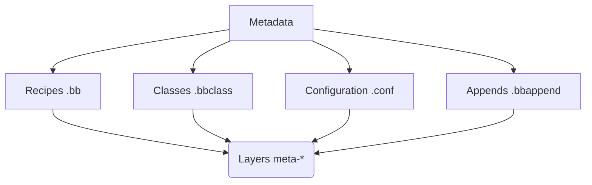
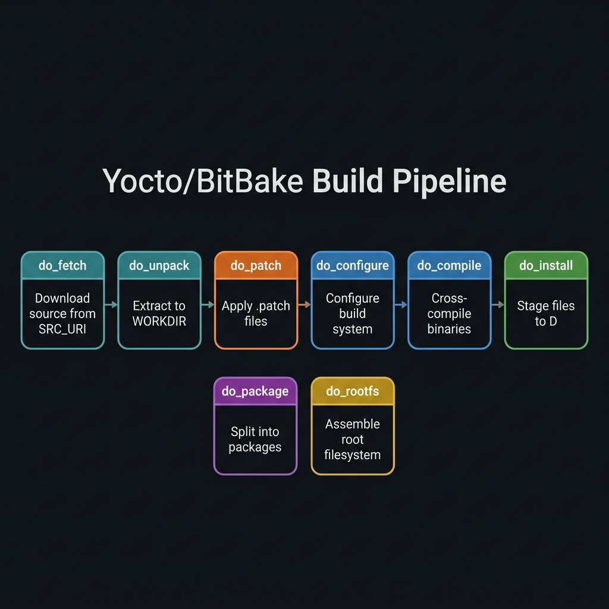

<div class="fd-panel">

**Learning Objectives**
By the end of this module, you will be able to:
1. Define the core metadata terms: Recipe, Class, Append, and Layer
2. Navigate the Poky source tree and the generated `build/` directory
3. Configure `local.conf` and `bblayers.conf` for a customized build
4. Explain the 6-stage OpenEmbedded build pipeline orchestrated by BitBake
5. Optimize host disk space usage using `rm_work`

</div>

:::note[Prerequisites]
- Completed [Embedded Linux Foundations & Yocto Quickstart](../embedded-linux-yocto-foundations/)
- A cloned Poky repository with the build environment initialized
:::

---

## 1. Yocto Project Core Terminology

Before diving deeper into the build system, you must master the fundamental building blocks of Yocto, collectively known as **Metadata**. 



| Term | Extension | Definition |
|---|---|---|
| **Recipe** | `.bb` | Logical sets of instructions detailing where to download source code, what patches to apply, how to compile (Make, CMake, Autotools), and how to package output binaries into `.ipk`/`.deb`/`.rpm` archives. |
| **Class** | `.bbclass` | Shared build logic inherited by recipes using `inherit class_name` (e.g., `inherit autotools`, `inherit cmake`, `inherit python3target`). |
| **Append** | `.bbappend` | Extends or modifies an existing recipe without altering the original `.bb` file. Crucial for overriding upstream settings cleanly. |
| **Configuration** | `.conf` | Defines global parameters, machine architectures (`local.conf`), and layer paths (`bblayers.conf`). |
| **Layer** | `meta-*` | Logical grouping of related metadata (e.g., `meta-arm`, `meta-raspberrypi`, `meta-ti`). Layers allow modular customization without modifying core OpenEmbedded recipes. |
| **BitBake** | N/A | The Python-based task execution engine that parses metadata and orchestrates the dependency graph and compilation process. |

### Yocto Project Compatible Layers

The Yocto Project maintains a strict standard for third-party layers. Layers that are "Yocto Project Compatible" are guaranteed to interoperate cleanly without polluting the global namespace or causing unexpected build failures. Search for compatible layers on the [OpenEmbedded Layer Index](https://layers.openembedded.org/).

---

## 2. Poky Source Tree Layout

Inspecting the root directory of a cloned Poky repository reveals its internal structure:

```text
poky/
├── bitbake/            # BitBake build engine source code & executable
├── documentation/      # Official Yocto manual & asciidoc/sphinx docs
├── meta/               # OE-Core metadata (base recipes, classes, conf)
├── meta-poky/          # Poky distribution metadata
├── meta-yocto-bsp/     # Hardware BSP recipes for reference boards & QEMU
├── oe-init-build-env   # Bash initialization script for build environment
└── scripts/            # Helper scripts (runqemu, bitbake-layers, devtool)
```

---

## 3. Deep Dive into the Build Directory (`build/`)

Executing `source oe-init-build-env` creates and enters the `build/` directory, the sandbox where all compilation occurs.

```text
build/
├── conf/               # User configuration directory
│   ├── bblayers.conf   # List of active layer paths parsed by BitBake
│   └── local.conf      # Local build environment variables
├── downloads/          # Downloaded upstream source tarballs & git repositories
├── sstate-cache/       # Shared state cache (speeds up rebuilds across builds)
└── tmp/                # Temporary build workspace & deploy outputs
    ├── work/           # Cross-compilation sandbox per recipe
    └── deploy/
        ├── images/     # Final binary bootloaders, kernel, dtb & flash images
        ├── rpm/        # Built RPM package feeds
        └── ipk/        # Built IPK package feeds
```

### 3.1 `conf/local.conf` (Environment Variables)

`local.conf` contains the global configuration for your specific build instance.

```bash
# Target machine architecture
MACHINE = "qemuarm"

# Parallel build concurrency settings (adjust based on your CPU cores)
BB_NUMBER_THREADS = "8"
PARALLEL_MAKE = "-j 8"

# Package format management (rpm, deb, or ipk)
PACKAGE_CLASSES = "package_ipk"

# Save disk space by removing temp work folders post-build
INHERIT += "rm_work"
```

### 3.2 `conf/bblayers.conf` (Layer Management)

`bblayers.conf` tells BitBake which layer directories to include in its search path. When you add a new hardware BSP or software layer, you add it here.

```bash
BBLAYERS ?= " \
  /path/to/poky/meta \
  /path/to/poky/meta-poky \
  /path/to/poky/meta-yocto-bsp \
  /path/to/poky/meta-custom \
  "
```

:::tip[Managing layers]
Instead of editing `bblayers.conf` manually, use the BitBake tool:
`bitbake-layers add-layer ../meta-raspberrypi`
:::

---

## 4. The Yocto Build System Workflow

The OpenEmbedded build engine executes a strict, multi-stage pipeline for every single recipe it processes. Understanding this pipeline is essential for debugging build failures.



### The 6 Core Build Tasks

1. **`do_fetch`**: Obtains source code from remote repositories (Git, HTTP, FTP, Tarballs) specified in `SRC_URI`.
2. **`do_unpack`**: Extracts the downloaded source files into the recipe's working directory (`tmp/work/...`).
3. **`do_patch`**: Automatically applies unified patch files (`.patch` or `.diff`) to the extracted source code.
4. **`do_configure`**: Prepares the build system (configures CMake flags, runs `./configure` scripts, or `make menuconfig`).
5. **`do_compile`**: Cross-compiles the source code into target binary object files using the cross-toolchain.
6. **`do_install`**: Installs compiled binaries into a staging directory (`${D}`) mimicking the final target filesystem layout.
7. **`do_package`**: Splits the installed files into granular packages (`PN`, `PN-dev`, `PN-dbg`) based on rules.
8. **`do_rootfs`**: Assembles the selected packages into the final target root filesystem image.

---

## 5. Saving Host Disk Space: The `rm_work` Class

Yocto builds consume **30 GB to 100+ GB** of disk space because BitBake retains all intermediate build object files inside `tmp/work/` for debugging purposes. 

If you are low on disk space, you can instruct BitBake to automatically delete the temporary build artifacts for a recipe once that recipe finishes compiling successfully.

Add this line to `conf/local.conf`:

```bash
INHERIT += "rm_work"
```

:::tip[Disk savings impact]
Enabling `rm_work` reduces host disk consumption from **~100 GB down to ~15 GB**, making Yocto builds manageable on smaller SSD drives. However, it means you cannot easily debug failed compilations post-mortem without rebuilding the specific recipe.
:::

---

## 6. Hands-On Lab Exercises

:::tip[LAB 2.1: Inspecting the Task Environment]
1. Pick a simple recipe, e.g., `zlib`.
2. List all available tasks for it: `bitbake -c listtasks zlib`
3. Execute only the fetch task: `bitbake -c fetch zlib`
4. Find where the downloaded file is stored inside the `build/downloads/` directory.
:::

:::tip[LAB 2.2: The Shared State Cache (sstate-cache)]
1. Run `bitbake core-image-minimal` (should be fast if you built it in the [Yocto foundations and fast emulation](../embedded-linux-yocto-foundations/) lesson).
2. Clean the build output for the `busybox` recipe: `bitbake -c clean busybox`
3. Rebuild it: `bitbake busybox`. Notice how fast it is? It pulled the pre-compiled binaries from the `sstate-cache`.
4. Now, clean the sstate cache as well: `bitbake -c cleansstate busybox`
5. Rebuild it again: `bitbake busybox`. Notice it takes much longer because it is actually compiling from source this time.
:::

---

## 7. Further Reading

| Resource | URL |
|---|---|
| Yocto Project Concepts Manual | [docs.yoctoproject.org/overview-manual/concepts.html](https://docs.yoctoproject.org/overview-manual/concepts.html) |
| BitBake Tasks Documentation | [docs.yoctoproject.org/bitbake/bitbake-user-manual/bitbake-user-manual-execution.html](https://docs.yoctoproject.org/bitbake/bitbake-user-manual/bitbake-user-manual-execution.html) |

---

