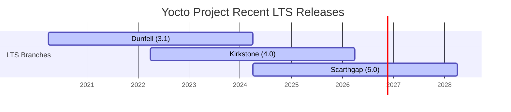

import { FileTree } from '@astrojs/starlight/components';


<div class="fd-panel">

**Learning Objectives**
By the end of this module, you will be able to:
1. Explain the Yocto Project release cycle and select the appropriate LTS branch
2. Add a Board Support Package (BSP) layer (`meta-ti`) to your build environment
3. Configure the `WIC` tool to automatically generate partitioned, bootable disk images
4. Explain the anatomy of a Kickstart (`.wks`) file

</div>

:::note[Prerequisites]
- Completed [BeagleBone Black Hardware Bring-Up](../beaglebone-black-hardware-bringup/)
- Working Poky build environment
:::

---

## 1. Yocto Project Release Cycles

The Yocto Project follows a strict 6-month release cadence, producing a new major version every April and October. To provide stability for production products, certain releases are designated as **Long Term Support (LTS)** and receive security patches and bug fixes for 4+ years.



### Choosing the Right Branch

When starting a new embedded Linux project, **always choose the most recent LTS release** (e.g., Scarthgap or Kirkstone). Do not use interim releases (like Mickledore or Nanbield) for commercial products, as they lose community support after just 7 months.

**Golden Rule of Yocto Layering:**
Every layer you clone (Poky, meta-ti, meta-raspberrypi, meta-xilinx) **must be checked out to the exact same release branch name**. Mixing a "Kirkstone" Poky with a "Scarthgap" BSP layer will cause severe parsing errors.

---

## 2. Integrating a Board Support Package (BSP) Layer

While `meta-yocto-bsp` (included in Poky) provides basic support for reference boards like the BeagleBone Black, silicon vendors maintain their own official BSP layers containing optimized kernels, proprietary graphics drivers, and hardware acceleration libraries.

For Texas Instruments (TI) processors like the AM335x on the BeagleBone, the official layer is `meta-ti`.

### Step 1: Clone the BSP Layer

```bash
cd /path/to/poky
# Remember: The branch must match your Poky branch!
git clone -b kirkstone git://git.yoctoproject.org/meta-ti
```

### Step 2: Anatomy of a BSP Layer

Let's examine the structure of `meta-ti`:

<FileTree>

- meta-ti/
  - conf/
    - machine/ Hardware definitions (beaglebone, am335x-evm)
    - layer.conf Layer priority and dependency definitions
  - recipes-kernel/
    - linux/ TI-optimized linux-ti-staging kernel recipes
  - recipes-bsp/
    - u-boot/ TI-optimized U-Boot bootloader recipes
  - recipes-graphics/ PowerVR GPU drivers (SGX)

</FileTree>

### Step 3: Add the Layer to Your Build

```bash
cd build/
bitbake-layers add-layer ../meta-ti/meta-ti-bsp
bitbake-layers add-layer ../meta-ti/meta-ti-extras
```

Verify it was added successfully:
```bash
bitbake-layers show-layers
```

### Step 4: Configure `local.conf`

```bash
# In conf/local.conf
MACHINE = "beaglebone"
```

---

## 3. The WIC Tool: Automated Disk Image Creation

In the [BeagleBone Black (AM335x)](../beaglebone-black-hardware-bringup/) lesson, you manually partitioned an SD card using `fdisk`. In a production environment or CI/CD pipeline, this process must be automated. The **OpenEmbedded Image Creator (WIC)** tool solves this by generating a ready-to-flash disk image containing the partition table, bootloader, kernel, and rootfs.

### 3.1 Enabling WIC in `local.conf`

To instruct BitBake to produce a `.wic` file for your image, add `wic` to the `IMAGE_FSTYPES` variable:

```bash
# Generate both a tarball and a WIC image
IMAGE_FSTYPES = "tar.bz2 wic"
```

### 3.2 Kickstart Files (`.wks`)

WIC relies on Kickstart (`.wks`) files to define the partition layout. BSP layers usually provide default `.wks` files. For the BeagleBone, it looks like this:

```text
# am335x-sdimage.wks
#
# Create a boot partition formatted as FAT32, copy boot files into it
part /boot --source bootimg-partition --ondisk mmcblk0 --fstype=vfat --label boot --active --align 4 --size 16

# Create the rootfs partition formatted as EXT4, copy root filesystem into it
part / --source rootfs --ondisk mmcblk0 --fstype=ext4 --label root --align 4
```

### 3.3 Flashing a WIC Image

When you run `bitbake core-image-minimal`, WIC parses the `.wks` file and generates `core-image-minimal-beaglebone.wic`.

Flash it to your SD card (replace `/dev/sdX` with your actual SD card device, e.g., `/dev/sdb`):

```bash
# WARNING: This will destroy all data on /dev/sdX
sudo dd if=tmp/deploy/images/beaglebone/core-image-minimal-beaglebone.wic of=/dev/sdX bs=4M status=progress
sync
```

---

## 4. Hands-On Lab Exercises

:::tip[LAB 4.1: Exploring Layer Priorities]
1. Run `bitbake-layers show-layers`. Look at the "Priority" column.
2. Open `meta-ti/meta-ti-bsp/conf/layer.conf` and find the `BBFILE_PRIORITY_meta-ti-bsp` variable.
3. If two layers provide a recipe for `u-boot`, the one with the higher priority number "wins". Which layer has higher priority: `meta-yocto-bsp` or `meta-ti-bsp`?
:::

:::tip[LAB 4.2: Inspecting WIC Images (QEMU/Host)]
You can inspect the contents of a generated `.wic` file without flashing it:
1. Locate the `.wic` file in `tmp/deploy/images/<machine>/`
2. Run `fdisk -l *.wic` to see the partition table inside the image file.
3. Observe how the FAT32 boot partition and ext4 rootfs partition match the rules defined in the `.wks` file.
:::

---

## 5. Further Reading

| Resource | URL |
|---|---|
| Yocto Project Releases | [wiki.yoctoproject.org/wiki/Releases](https://wiki.yoctoproject.org/wiki/Releases) |
| WIC Documentation | [docs.yoctoproject.org/dev-manual/wic.html](https://docs.yoctoproject.org/dev-manual/wic.html) |
| OpenEmbedded Layer Index | [layers.openembedded.org](https://layers.openembedded.org/) |

---

